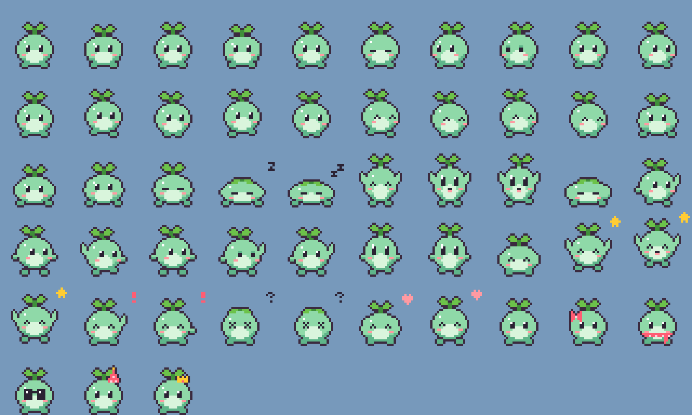

# pixel-pal

**Your desktop buddy with a job.** Shimeji, but it can actually do stuff.

Pip is a small pixel-art sprout creature that lives on your Windows desktop. It walks, runs,
jumps, climbs, sits on your windows, naps, and can be picked up and thrown. It also opens apps,
runs timers and reminders, runs automations you approve, and tells you when the battery is low.



## Install and run (Windows 10/11)

1. Install [Python 3.10+](https://www.python.org/downloads/) (tick "Add python.exe to PATH").
2. Double-click **`run_pixelpal.bat`**. The first run creates a private `.venv` and installs
   PySide6; after that it starts instantly with no console window.

Or by hand:

```bat
py -m venv .venv
.venv\Scripts\pip install -e .
.venv\Scripts\pythonw -m pixelpal
```

To quit: right-click Pip or the tray icon and choose **Quit pixel-pal**.

### Standalone .exe

Run **`build_exe.bat`**. It produces `dist\pixel-pal.exe` with PyInstaller, which runs without
Python installed. The GitHub Actions workflow builds the same file as a downloadable artifact.

## Using it

| You do | Pip does |
| --- | --- |
| Left-click | Gets petted (and wakes up if asleep) |
| Drag and release | Dangles, then falls or flies in the direction you threw it |
| Right-click (or the tray icon's menu) | Shows the menu below |
| Left-click the tray icon | Drops in from the top of the screen above your pointer |

Menu:

- **Open** – your quick actions: apps, folders and https links.
- **Timers** – Pomodoro, break, countdown, reminder; running timers are listed and can be cancelled.
  Timers are saved, so a reminder survives a restart.
- **Automations** – commands you have approved.
- **Come here!**, **Take a nap / Wake up**, **Quiet mode**, **Settings…**, **Quit**.

Finishing timers and automations earns accessories (bow, scarf, shades, party hat, crown), which
you can swap in *Settings → Look*, along with body colour and size.

Settings also cover activity level, chattiness, speech bubbles, pointer following, climbing,
window interaction, hiding during full-screen apps, alert thresholds, and launch at sign-in.

Everything is stored locally in `%APPDATA%\pixel-pal\config.json`. There is no network use and no
account; the only things that reach outside the app are the links and commands you configure.

## Safety of automations

- A command only runs after you approve its exact text in a dialog. The approval is a hash of the
  command, so changing it in Settings or in the JSON file revokes it and you are asked again.
- Commands are started directly, never through a shell: `&&`, pipes and redirects are not
  interpreted. To run a script, name its interpreter, e.g. `powershell -File C:\scripts\backup.ps1`.
- Nothing is ever elevated. Launch-at-login uses the per-user `HKCU\...\Run` key.
- Quick-action links must be `http` or `https`.

## How it is built

```
src/pixelpal/
  core/        pure Python, no Qt or Windows imports, fully unit-tested
    world.py       screens + windows -> floors and walls (with occlusion and multi-monitor edges)
    physics.py     gravity, landing, ledges, wall climbing, riding moving windows, respawn
    behavior.py    the brain: picks actions from mood, settings and surroundings
    mood.py        energy / joy / curiosity / excitement / confusion -> one visible mood
    personality.py phrases, chatter pacing, accessory rewards
    timers.py, sysmon.py, animation.py
  sprites/     Pip, drawn procedurally from poses (no image files), plus palette generation
  platform/    base.py = interface + safe fallback; win32.py = ctypes (EnumWindows, DWM, power, Run key)
  abilities/   launcher, timers, automations, system monitor
  ui/          pet window, speech bubble, menu, settings dialog, sprite renderer
  app.py       the controller that ties it together
```

**Adding an ability:** subclass `abilities.base.Ability`, implement `menu()` and/or `tick()`, use
`self.ctx` (`say`, `celebrate`, `alert`, `confuse`, `ask_*`, `confirm`, `config`) and add it to
`default_abilities()` in `abilities/__init__.py`.

**Adding a character:** provide a module shaped like `sprites/pip.py` (an `ANIMATIONS` dict of
frames and a `render()` that returns a palette-index grid).

Performance: the pet ticks at about 30 fps while moving and about 8 fps while resting, scans
windows four times a second, and caches every rendered frame.

## Development

```bash
pip install -e .[dev]
pytest
```

The suite (80 tests) runs headlessly with Qt's `offscreen` platform. It includes a soak test that
simulates half an hour of pet life on a changing two-monitor desktop for several random seeds.

## What has and has not been tested

This project was developed in a Linux container, so:

**Tested (automated, on Linux):** physics, window surfaces, behaviour, moods, timers, system-alert
logic, config persistence, automation approval and no-shell execution, sprite generation, DPI
coordinate conversion, and the real Qt app driven headlessly against fake windows (dragging,
throwing, landing on windows, falling when a window closes, full-screen hiding, bubbles, menu,
settings).

**Not yet run on a real Windows desktop:**

- `platform/win32.py`: window enumeration, DWM frame bounds, battery/CPU sampling, the Run key.
  `tests/test_win32_live.py` covers these and runs in the Windows CI job.
- Click-through around the sprite. It relies on Windows not delivering mouse input to fully
  transparent pixels of a layered window, which is how Qt implements translucent windows.
- Mixed-DPI multi-monitor setups. The conversion is unit-tested, but assumes Qt's convention that
  a screen keeps its physical origin and only its size is scaled.
- The tray icon, `run_pixelpal.bat`, `build_exe.bat` and the resulting `.exe`.

## Known limits

- Pip can stand on the visible top edge of a window and climb its visible sides, but does not
  collide with windows while flying through the air (it would get stuck constantly otherwise).
- Windows that are maximised, minimised, cloaked (other virtual desktops) or tool windows are
  ignored. Elevated windows are still seen, since only their position is read.
- On non-Windows systems the app runs with screen edges only.
